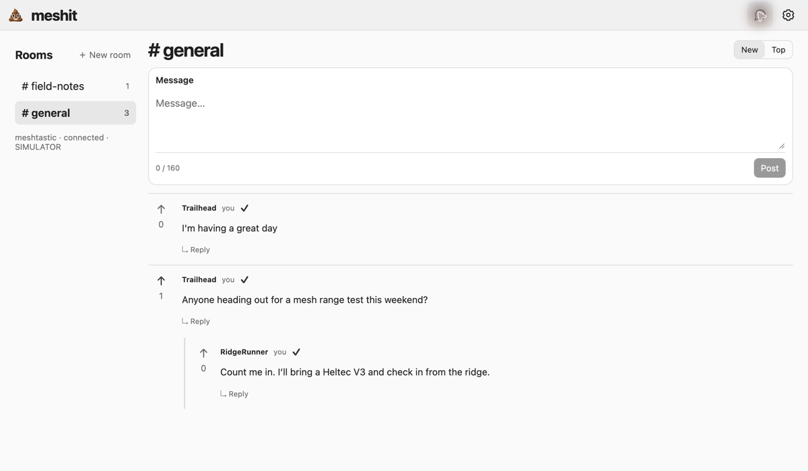
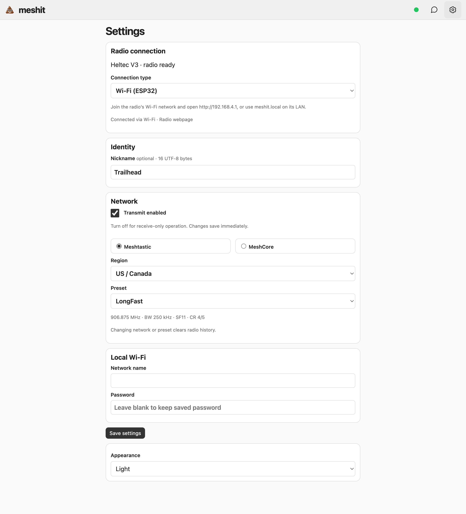

# 💩 meshit

**[Install firmware → meshit.pdxlocs.com](https://meshit.pdxlocs.com)** · [GitHub Releases](https://github.com/pdxlocations/meshit/releases) · [Wiki](https://github.com/pdxlocations/meshit/wiki) · [Documentation source](docs/wiki/Home.md)

Small, threaded LoRa chat for **Heltec V3/V4 (ESP32-S3)** and **RAK4631 / T114 (nRF52840)**. meshit originates encrypted application traffic on a selected Meshtastic or MeshCore network. Existing infrastructure supplies the relays; meshit never forwards ordinary received traffic.

Chat has rooms, replies, removable upvotes, New/Top sorting, and an optional nickname (Anonymous by default). Posts and replies accept **160 Unicode characters**. A check means **another radio was heard rebroadcasting the message**, not that everyone received it. Without a check, the radio makes at most three retries after the initial send.

There are no locations, node advertisements, direct messages, explicit radio acknowledgments, or periodic history broadcasts. The single exception to the no-forwarding rule is answering an explicit request for a retained message, with delayed response suppression.

## Screenshots

Use the chat-bubble icon for conversations and the gear icon for Settings.

**Light mode**



**Settings**



Captured from the local simulator with sample messages. Rebroadcast checks are simulated; screenshots do not establish hardware interoperability.

## Get started

1. Open **[meshit.pdxlocs.com](https://meshit.pdxlocs.com)** and [install the firmware for your board](docs/wiki/Installation.md). Heltec V3/V4 use browser USB installation; RAK4631 and T114 use downloads matching their installed S140 SoftDevice.
2. [Connect the companion](docs/wiki/Connection-and-Settings.md) over local Wi-Fi on ESP or Bluetooth on all supported boards.
3. Choose a matching network and preset, then [join a room and post](docs/wiki/Using-Meshit.md).

See the [wiki](https://github.com/pdxlocations/meshit/wiki) for [hardware and presets](docs/wiki/Hardware-and-Presets.md), [mobile companions](docs/wiki/Mobile-Companions.md), [troubleshooting](docs/wiki/Troubleshooting.md), and [development and releases](docs/wiki/Development-and-Releases.md).

## Run the companion preview

Install [PlatformIO](https://platformio.org/), Node.js 22+, and a C++17 compiler. Then:

```sh
pio pkg install -e heltec-v3
npm ci
npm run dev
```

Open **http://127.0.0.1:8787**. The preview uses the actual C++ chat core and **simulates** rebroadcasts. It does not transmit radio traffic. Preview history lasts for the server process; browser drafts and the last received feed are saved locally.

## Build firmware

```sh
npm run build:firmware
npm run package:firmware
```

Packages appear in `dist/firmware/` with a SHA-256 manifest. nRF52840 UF2 packages contain application firmware only. **Match the installed SoftDevice:** `meshit-rak4631.uf2` is S140 7.3.0; `meshit-rak4631-s140-6-1-1.uf2` is S140 6.1.1. The packager checks the application offset, MCU family, and reserved-storage boundary. T114 uses `meshit-heltec-t114.uf2` with S140 7.3.0. No bootloader replacement is needed or performed.

Heltec V3 and V4 packages contain an app-only update (`meshit-heltec-v3.bin`, offset `0x10000`) and a full-flash fresh-install image (`meshit-heltec-v3-factory.bin`, offset `0x0`). The latter replaces saved data. The companion website is embedded in the application; neither path needs a separate filesystem upload. PlatformIO can also install directly:

```sh
pio run -e heltec-v3 -t upload
```

The nRF builds reserve `0x80000–0xECFFF` for meshit storage; linker limits prevent application overlap. Board pin mappings and the two RAK SoftDevice layouts take cues from the neighboring Form8 project. Build profiles also include V4.2 OLED / GC1109 (`heltec-v4`), V4.3 OLED / KCT8103L (`heltec-v4-3`), and T114 (`heltec-t114`). Select the exact V4 revision; its amplifier control differs. V4 uses 16 MiB flash; V3 uses 8 MiB. T114’s TFT and optional V4 TFT are not driven by these profiles.

## Web flasher and GitHub releases

The **[web flasher at meshit.pdxlocs.com](https://meshit.pdxlocs.com)** installs ESP firmware over browser USB and provides verified RAK4631 / T114 UF2/HEX downloads with explicit SoftDevice matching. Deployment and self-hosting instructions are in [webflasher/README.md](webflasher/README.md). It automatically discovers published builds from `pdxlocations/meshit`.

GitHub workflows run CI on branch pushes and pull requests, build all firmware and the Android companion, and package release downloads. **Release firmware → Run workflow** accepts a numeric version and publishes a beta named `vVERSION.COMMIT-beta` after all checks pass. Publishing an existing tagged release also builds and attaches its downloads. The release tag is reserved at the selected commit before builds start, so later pushes do not change that release. Publishing uses that verified existing tag without passing an outdated commit as a new tag target. Tag pushes do not start a second CI build. Only the tag-reservation and publishing jobs receive repository write permission. A failed build may leave a reserved tag without a published release; rerunning the same version/commit reuses it.

For the equivalent local release bundle:

```sh
npm run build:android
npm run package:release
```

This uses the packaged firmware above and creates `dist/meshit-release.zip`, its SHA-256 checksum, and the standalone Android APK/checksum. The ZIP contains `esp32/`, `nrf52/`, and the uploadable `webflasher/`. iOS builds are local-only in Xcode; GitHub Actions does not build or upload an iOS app. Signing an iPhone release requires separate provisioning.

## Connect

- **ESP:** read the `meshit-…` setup Wi-Fi name and eight-digit password on the radio’s OLED. The password is a four-digit PIN repeated twice (for example, `48214821`). If the display is absent or cannot initialize, join the `meshit-…` Wi-Fi network with **`12345678`**. Open **http://192.168.4.1**; no serial monitor is needed. Choose the network, region, and preset. In Settings, supply your home Wi-Fi details, then restart the radio and visit **http://meshit.local**. The setup hotspot closes after one minute on the LAN; the display then shows `meshit.local` and the LAN IP.
- **Wi-Fi (ESP32):** join `meshit-…` in device Wi-Fi settings. The native companion uses `192.168.4.1`; browsers use the radio’s own page.
- **Bluetooth (ESP32 / nRF52):** in Settings choose **Find radios**, select a radio, then **Connect**. ESP32 pairing uses the last six digits of its setup Wi-Fi password (`345678` without a display). Disconnect Wi-Fi clients first; Bluetooth pauses ESP32 Wi-Fi until you choose **Disconnect**. iPhone uses the native companion.
- **Mobile:** the UI is bundled locally, so it can open without an internet connection. Connect by Bluetooth or by local Wi-Fi on ESP. Local drafts and a bounded cached feed remain available while disconnected.

The initial preset catalog covers US/Canada and EU 868 MHz, with Meshtastic LongFast, MeshCore narrow, and the user-supplied **MeshOregon: 918.5 MHz, BW125, SF8, CR4/5**. Meshtastic transport uses the standard public key and the preset’s built-in channel hash automatically; no channel name is entered during setup. All meshit rooms share one transport channel. Switching network or preset starts a fresh radio history.

## Android and iOS framework

```sh
npm run mobile:android
npm run mobile:ios
```

The scripts generate native projects, configure Bluetooth/local-network access, and reuse `web/`. Android requires Android 12+, Java 21, and an Android SDK. iOS requires iOS 16+ and Xcode. The iOS setup uses Swift Package Manager and adapts the installed Bluetooth plugin's registration; CocoaPods is unnecessary. After web changes, use `npm run mobile:sync` to regenerate assets and the iOS Bluetooth adapter.

Open `android/` in Android Studio or `ios/App/App.xcodeproj` in Xcode. Native projects and build products are generated and ignored by Git. Signing, distribution, and real-phone BLE testing are separate release steps. Bluetooth cannot be verified in an iOS simulator.

## History and encryption

The radio keeps **200 posts and replies total across rooms**, evicting lowest-voted first and then oldest. Evicting a parent removes its entire descendant thread, even if replies have votes. Upvoted messages remain until displaced. A room disappears when its last retained message disappears; empty room drafts remain local until their first post.

Numbering is automatic: a six-byte ID combines a sender identity and its counter. Hearing a new sender establishes a baseline without downloading old history. Subsequent gaps trigger bounded requests. Old missing posts are requested only when a newly heard upvote references them. No central numbering server or clock synchronization is needed.

Application content uses **ChaCha20-Poly1305** with a built-in shared key and random 96-bit nonces. No key entry is required. It obscures broker contents even if an MQTT gateway removes transport encryption. The key is public in this source; this is not secrecy from other meshit users or someone inspecting the implementation. Transport metadata and traffic volume remain visible. MQTT forwarding depends on the gateway's application-port/channel filters; compatibility does not guarantee passage through every broker.

See [protocol and bounds](docs/PROTOCOL.md), [implementation decisions](REQUIREMENTS.md), and [verification](docs/VALIDATION.md).

```sh
npm test
```
