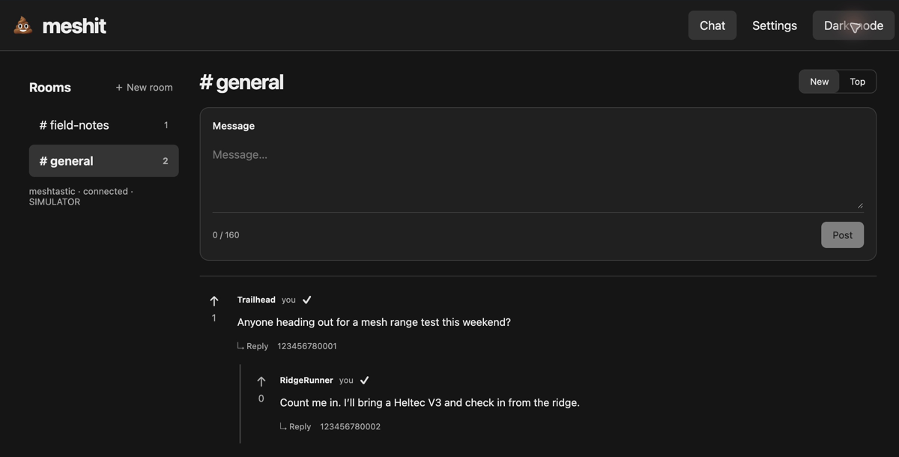

# 💩 Meshit wiki

Small, threaded LoRa chat on Heltec V3 and RAK4631, using nearby Meshtastic or MeshCore infrastructure.

**[Install firmware](https://meshit.pdxlocs.com)** · **[Release downloads](https://github.com/pdxlocations/meshit/releases)**

The companion has a compact sans-serif layout and Paper/Graphite light/dark themes. Use **Dark mode** in the header to switch; your choice is saved on that companion.

## Start here

1. [Install firmware](Installation.md) for your board.
2. [Connect and configure](Connection-and-Settings.md) your radio and local network.
3. [Use rooms, replies, and upvotes](Using-Meshit.md).

## Guides

- [Supported hardware and radio presets](Hardware-and-Presets.md)
- [Android and iOS companions](Mobile-Companions.md)
- [Troubleshooting](Troubleshooting.md)
- [History, encryption, and protocol](History-and-Security.md)
- [Development and releases](Development-and-Releases.md)
- [Host the web flasher](../../webflasher/README.md)
- [Verification record](../VALIDATION.md)

Screenshots from the local simulator with sample messages. Rebroadcast checks are simulated; this is not a hardware range test.
